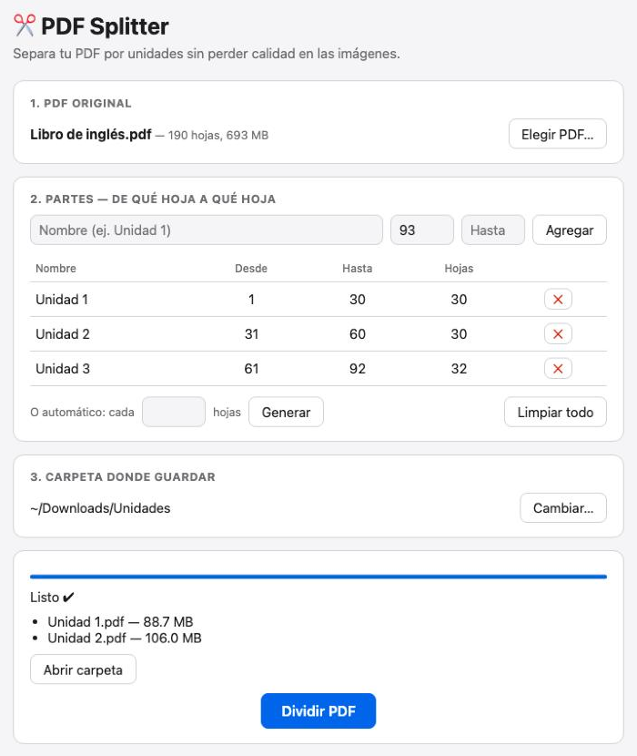

# ✂️ PDF Splitter

Split a huge PDF into smaller files by page range — **without losing image quality**.

Herramienta para dividir un PDF pesado en partes (por ejemplo, por unidad) eligiendo de qué hoja a qué hoja. **Las imágenes no pierden calidad.**



[Español](#español) · [English](#english)

---

## Español

### ¿Por qué?

Comprimir un PDF de cientos de MB suele arruinar las imágenes. PDF Splitter **no comprime ni re-codifica nada**: copia las hojas que eliges tal cual a un PDF nuevo. Cada parte pesa más o menos lo que le corresponde del original y se ve exactamente igual.

### Características

- Interfaz gráfica sencilla que se abre en tu navegador. **Todo pasa en tu computadora**; nada se sube a internet.
- Varias partes en una sola pasada, cada una con su nombre (ej. *Unidad 1*, *Unidad 2*…).
- Modo automático: dividir "cada N hojas".
- Selectores nativos de macOS para elegir el PDF y la carpeta de salida.
- Barra de progreso, aviso si un archivo ya existe y protección para no sobrescribir el PDF original.
- Funciona con PDFs muy grandes (probado con uno de 700 MB y 190 hojas).

### Requisitos

- **macOS** con **Python 3.9 o más reciente** (macOS ya trae `python3`; si te lo pide, acepta instalar las *Command Line Tools*).
- La librería [`pypdf`](https://pypi.org/project/pypdf/).

> Los botones "Elegir PDF…" y "Cambiar…" usan diálogos de macOS (`osascript`). En Windows o Linux el resto funciona, pero esos dos botones no abrirán el selector.

### Instalación

```bash
git clone https://github.com/EriccGame/pdf-splitter.git
cd pdf-splitter
pip3 install --user -r requirements.txt
```

### Uso

**Opción 1 — doble clic:** abre `Open PDF Splitter.command`.
La primera vez macOS puede bloquearlo: haz clic derecho → **Abrir** → **Abrir**. Este lanzador también instala `pypdf` si falta.

**Opción 2 — Terminal:**

```bash
python3 pdf_splitter.py
```

Se abre tu navegador en `http://127.0.0.1:8765/`. Luego:

1. **Elegir PDF…** y selecciona tu archivo.
2. Escribe un **nombre**, la hoja **Desde** y la hoja **Hasta**, y pulsa **Agregar** (o Enter). Repite para cada unidad; "Desde" se llena solo con la hoja siguiente.
   - O usa **"cada N hojas" → Generar** para dividirlo automáticamente.
3. (Opcional) **Cambiar…** la carpeta de salida. Por defecto se guarda junto al PDF original.
4. Pulsa **Dividir PDF**. Al terminar verás el tamaño de cada archivo y un botón para abrir la carpeta.

Deja abierta la ventana de Terminal mientras la usas; ciérrala (o `Ctrl+C`) para salir.

### Problemas comunes

| Problema | Solución |
|---|---|
| `No module named 'pypdf'` | `pip3 install --user -r requirements.txt` |
| `Address already in use` | Ya hay otra copia abierta. Ciérrala o cambia `PUERTO` en `pdf_splitter.py`. |
| macOS no deja abrir el `.command` | Clic derecho → **Abrir**, o en Terminal: `chmod +x "Open PDF Splitter.command"` |
| Las partes pesan casi lo mismo que el original | Normal si unas pocas hojas tienen imágenes muy pesadas: la herramienta no comprime para no perder calidad. |
| Aparece "wrong pointing object" en la Terminal | Son avisos de PDFs con pequeños errores internos; se ignoran y el resultado sale bien. |

### ¿Por qué en el navegador y no en una ventana propia?

El Python que viene con macOS incluye una versión vieja de Tk que se cierra al abrir ventanas en macOS recientes. La interfaz web local evita ese problema sin instalar nada extra.

---

## English

### Why?

Compressing a PDF that weighs hundreds of MB usually ruins the images. PDF Splitter **doesn't compress or re-encode anything**: it copies the pages you choose as-is into a new PDF, so each part looks identical to the original.

### Features

- Simple GUI that opens in your browser. **Everything runs locally**; nothing is uploaded.
- Several named parts in one go (e.g. *Unit 1*, *Unit 2*…).
- Automatic mode: split "every N pages".
- Native macOS file/folder pickers.
- Progress bar, overwrite warning, and protection against overwriting the source PDF.
- Handles very large PDFs (tested with a 700 MB, 190-page file).

### Requirements

- **macOS** with **Python 3.9+** (the system `python3` works).
- [`pypdf`](https://pypi.org/project/pypdf/).

> The file/folder picker buttons use macOS dialogs (`osascript`). On Windows/Linux the rest works, but those two buttons won't open a picker.

### Install

```bash
git clone https://github.com/EriccGame/pdf-splitter.git
cd pdf-splitter
pip3 install --user -r requirements.txt
```

### Run

Double-click `Open PDF Splitter.command` (first time: right-click → **Open**), or:

```bash
python3 pdf_splitter.py
```

Your browser opens at `http://127.0.0.1:8765/`. Pick the PDF, add each part with a name and its **From**/**To** pages (or use "every N pages"), optionally change the output folder, then click **Dividir PDF** (Split). The interface is in Spanish.

### How it works

`pdf_splitter.py` is a single file using only the Python standard library plus `pypdf`:

- A small `http.server` bound to `127.0.0.1` serves the page and a tiny JSON API.
- Splitting runs in a background thread with `pypdf.PdfWriter.add_page`, which copies page objects (images included) without re-encoding; `compress_identical_objects()` drops duplicate or unused objects.

### Project structure

```
pdf-splitter/
├── pdf_splitter.py            # app (server + UI + splitting logic)
├── Open PDF Splitter.command  # macOS double-click launcher
├── requirements.txt
└── docs/screenshot.png
```
